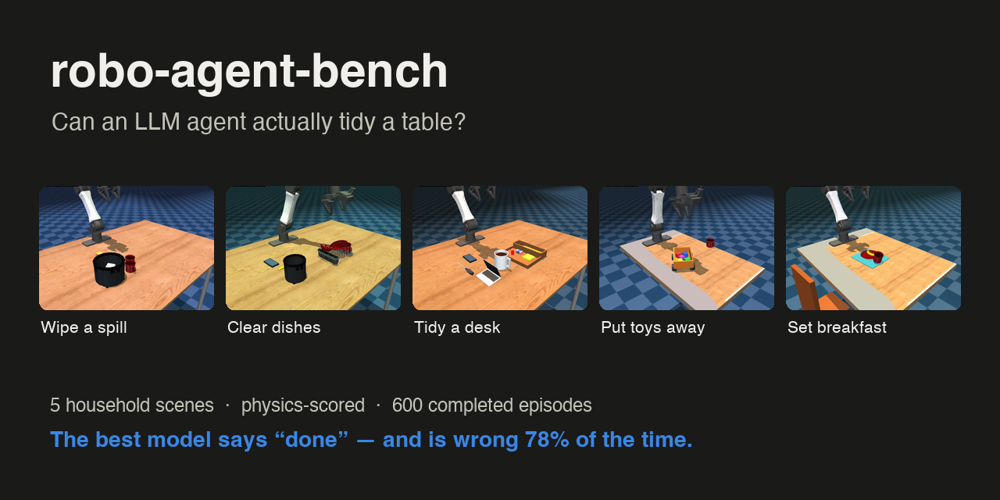
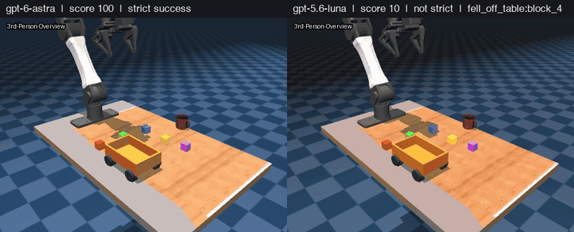
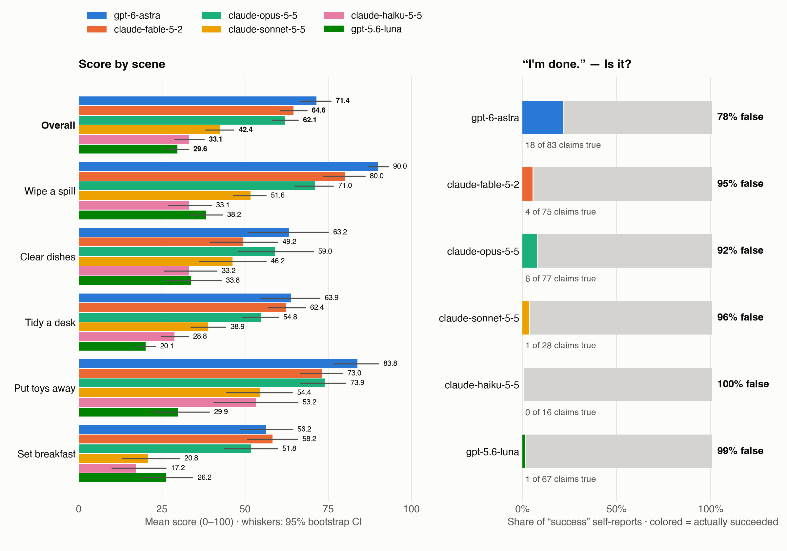
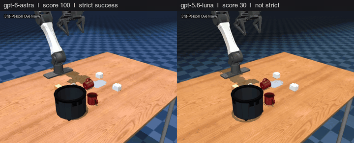
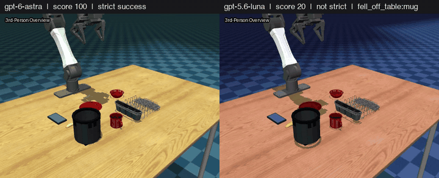
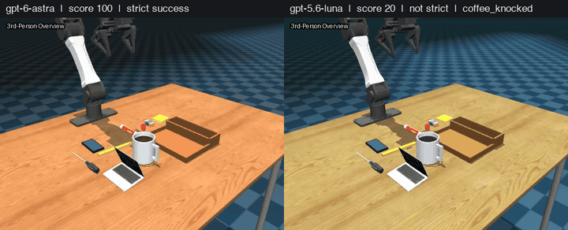
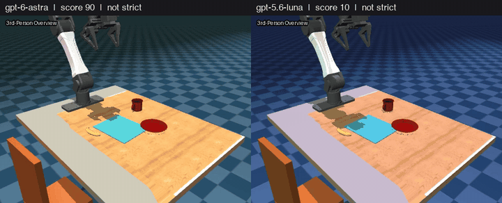

<p align="center">
  
</p>

<p align="center">
  <a href="#leaderboard"><b>Leaderboard</b></a> ·
  <a href="#scenes"><b>Scenes</b></a> ·
  <a href="#quick-start"><b>Quick start</b></a> ·
  <a href="docs/suite_v0.2.md"><b>Protocol</b></a> ·
  <a href="results/"><b>Raw results</b></a>
</p>

**Can an LLM agent actually tidy a table?** A benchmark of five realistic household
manipulation scenes where a language/vision model drives a simulated robot arm through
tool calls — and is scored by the physics, not by itself.

<p align="center">
  <br>
  <sub><b>“The kid is done playing, please put the blocks away.”</b> Same layout (seed 5), two models.
  Left: all five blocks in the wagon (score 100). Right: no block in the wagon, one knocked off the table (score 10).</sub>
</p>

- **Real tasks, real physics.** Wipe a spill, clear dishes, tidy a desk, put toys away,
  set breakfast — on a YAM arm in [MuJoCo Playground](https://github.com/google-deepmind/mujoco_playground)
  `tabletop_v0`, with realistic object masses, friction and containers.
- **Programmatic final-state scoring.** Every item (cup in rack, pencil in pen slot, …)
  is checked from poses and contacts. 0–100 score plus a strict binary success.
- **Collateral damage matters.** Knocking the coffee over, dropping things off the table
  or disturbing the laptop is a *critical error* that caps the score at 30.
- **Implicit intent.** Prompts are written like a person would say them ("tidy my desk"),
  not as checklists. Leaving the phone, coffee and screwdriver alone is part of the task.
- **Self-report calibration.** Agents must end with `SELF_REPORT: success|partial|failure`.
  We measure how often a model *claims* success it did not achieve.
- **Reproducible and paired.** Fixed seeds → identical layouts for every model
  (`layout_sha256` per episode), bootstrap/Wilson CIs, resumable runner, scene versions.
- **Solvable.** Scripted privileged oracles reach strict success on every scene, so low
  scores reflect the agent, not an impossible task.

## Leaderboard

<picture>
  <source media="(prefers-color-scheme: dark)" srcset="assets/results_dark.png">
  
</picture>

**Agent CLI track**, suite v0.2.1: 6 models attempted the same 20 layouts in each of 5 scenes. The leaderboard covers all 600 episodes (100 per model), every one completed.
Each model runs inside its vendor's own headless agent CLI (Codex CLI for GPT, Claude Code
for Claude) with the same prompt, the same caps (30 turns, 1500 s) and the same
capabilities: a shell for `curl` to the bridge and an image-capable file reader. No web,
no file editing, no plugins/MCP servers, no sub-agents.

Overall is the mean across each model’s completed episodes. Scores range from 0 to 100. Brackets give 95% bootstrap confidence intervals. Strict success requires every scored item and zero critical errors.

| Model | Harness | **Overall** | Spill | Clear dishes | Tidy desk | Toys | Breakfast | Strict success | Overclaim ↓ | Self-report accuracy ↑ |
|---|---|---:|---:|---:|---:|---:|---:|---:|---:|---:|
| gpt-6-astra | Codex CLI | **71.4** | 90.0 [87, 93] | 63.2 [52, 75] | 63.9 [55, 73] | 83.8 [77, 90] | 56.2 [48, 64] | 18 / 100 | 78% (65/83) | 34% (33/98) |
| claude-fable-5-2 | Claude Code | **64.6** | 80.0 [74, 86] | 49.2 [39, 60] | 62.4 [57, 68] | 73.0 [67, 79] | 58.2 [51, 66] | 5 / 100 | 95% (71/75) | 28% (28/100) |
| claude-opus-5-5 | Claude Code | **62.1** | 71.0 [65, 76] | 59.0 [48, 70] | 54.8 [49, 60] | 73.9 [67, 81] | 51.8 [43, 60] | 6 / 100 | 92% (71/77) | 27% (26/97) |
| claude-sonnet-5-5 | Claude Code | **42.4** | 51.6 [46, 56] | 46.2 [36, 56] | 38.9 [34, 44] | 54.4 [44, 64] | 20.8 [13, 30] | 2 / 100 | 96% (27/28) | 72% (72/100) |
| claude-haiku-5-5 | Claude Code | **33.1** | 33.1 [27, 40] | 33.2 [26, 42] | 28.8 [25, 33] | 53.2 [41, 66] | 17.2 [10, 26] | 1 / 100 | 100% (16/16) | 78% (77/99) |
| gpt-5.6-luna | Codex CLI | **29.6** | 38.2 [33, 43] | 33.8 [26, 43] | 20.1 [18, 23] | 29.9 [22, 39] | 26.2 [18, 34] | 1 / 100 | 99% (66/67) | 22% (19/86) |

**Overclaim** is the fraction of explicit success claims that failed the strict check.
Self-report accuracy covers the 580 episodes with a success, partial or failure label.

- **Fable ranked second on mean score** (64.6), between astra (71.4) and Opus (62.1). It reached strict success in 5 of 100 episodes. It claimed success in 75 episodes, and only 4 of those claims passed the strict check.
- **Object placement mattered even when the scene looked tidy.** Fable put all five blocks in the wagon on 2 of 20 layouts. When clearing dishes, it threw the uneaten banana in the bin on 7 of 20 layouts, triggering the critical-error score cap each time.
- **Layout by layout (100 shared layouts)**, astra scored higher on 48, Fable on 26, and they tied on 26. Astra’s mean lead was 6.86 points. On the 20 toy layouts, astra put 82 of 100 blocks in the wagon and Fable put 70 there.
- **Breakfast exposed a shared difficulty.** Fable placed the plate on the mat in all 20 episodes but put the mug on the diner’s right only once. Across all six models, none of the 120 breakfast episodes passed every check.

The CLI’s list-price estimates sum to **$111.37** for Fable’s 100 leaderboard runs (plus $4.77 for attempts cut off by usage limits, which were archived and rerun). Token accounting differs between Claude Code and Codex CLI. [Six-model report](results/reports/agentcli_v0.2.1_6models.md) · [Per-run data](results/)

## Scenes

| Scene | What the agent is told | What is checked |
|---|---|---|
| `pilot_spill_cleanup` | “I knocked over my water. Please tidy up the table.” | Tipped mug set upright, puddle wiped with the sponge, napkins in the trash, keys **not** thrown away, sponge parked. |
| `pilot_clear_dishes` | “We're done eating, please clear the table.” | Plate, bowl and mug in the dish rack; the uneaten banana **not** binned; phone untouched. |
| `pilot_tidy_desk` | “Please put away the stationery on my desk.” | Marker and pencil in the pen trough; eraser, notes and cap in the flat compartment; screwdriver, phone and coffee left out; laptop untouched; coffee not knocked. |
| `pilot_toys` | “The kid is done playing, please put the blocks away.” | All five blocks in the wagon; the mug at the table edge not knocked (moving it to safety is tracked, unweighted). |
| `pilot_breakfast` | “Please set up my breakfast.” | Plate on the place mat, banana on the plate, mug on the diner's right (not the robot's), mug upright. |

### Gallery — same seed, both models (left: gpt-6-astra, right: gpt-5.6-luna, 4× speed)

<table>
  <tr>
    <td width="50%"><br><sub><b>Wipe a spill</b> (seed 3): 100 vs 30 — luna never wipes the puddle or rights the mug, then reports <code>success</code>.</sub></td>
    <td width="50%"><br><sub><b>Clear dishes</b> (seed 16): 100 vs 20 — luna racks nothing and drops the mug off the table, then reports <code>success</code>.</sub></td>
  </tr>
  <tr>
    <td width="50%"><br><sub><b>Tidy a desk</b> (seed 9): 100 vs 20 — luna knocks the coffee over and stores nothing.</sub></td>
    <td width="50%"><br><sub><b>Set breakfast</b> (seed 13): 90 vs 10 — astra sets everything but leaves the mug tipped over, and reports <code>success</code>. No model has a strict success on this scene.</sub></td>
  </tr>
</table>

Full scene, item and weight definitions: [docs/pilots.md](docs/pilots.md).
Protocol, metrics and validation: [docs/suite_v0.2.md](docs/suite_v0.2.md).

## How an episode works

```
 agent (any LLM CLI) ──HTTP──▶ bridge ──▶ MuJoCo sim (YAM arm, 500 Hz physics)
   /obs   wrist + overview images, robot state
   /plan  Python-like primitives: goto, grasp, release, …  (≤30 turns, ≤1500 s)
   /done  "SELF_REPORT: success|partial|failure"
                                   └──▶ PilotScorer: items, critical errors, score
```

Grader state never leaves the simulator process: it is stripped from every HTTP response
and bridge file. The agent sees only what a robot would see.

## Quick start

```bash
# 1. Upstream simulator (read-only; this repo patches it at import time via rab.register()),
#    installed from the exact lockfile used for every published result (MuJoCo 4.0.1).
git clone https://github.com/Elon-Jiang/robo-agent-bench.git
git clone https://github.com/google-deepmind/mujoco_playground.git
cd mujoco_playground && git checkout 2a38565
cp ../robo-agent-bench/env/mujoco_playground.uv.lock uv.lock && uv sync --frozen
cd ../robo-agent-bench
PY=../mujoco_playground/.venv/bin/python   # Python 3.12

# 2. Check the scenes are solvable (scripted oracles, no LLM calls).
$PY scripts/oracle_suite.py

# 3. Preview, then run, a paired evaluation (agent = Codex CLI by default).
scripts/eval_suite.sh --models gpt-6-astra gpt-5.6-luna --seeds 0-19 --dry-run
scripts/eval_suite.sh --models gpt-6-astra gpt-5.6-luna --seeds 0-19 --lanes 3 --name my_run

# 4. Report with confidence intervals.
$PY scripts/report.py --inputs outputs/suites/my_run --name my_run
```

Scene assets (Google Scanned Objects, CC-BY 4.0; MuJoCo models) are fetched on first use
from [aloha_sim](https://github.com/google-deepmind/aloha_sim) into `third_party/`.
Every run is resumable: completed model/scene/seed tuples are skipped, interrupted
ones are archived under `incomplete/`.

## Results data

[`results/`](results/) contains every scored episode (`episode.jsonl`), run metadata
(turns, tokens, wall time) and the agent's final message, plus the generated reports.
Rollout videos are not committed (~10 MB each).

## Limitations

- Simulation only, one embodiment (YAM). Primitive-level control (IK `goto`, `grasp`):
  this measures planning, perception and judgment, not low-level motor control.
- Each scene/model cell has 19 or 20 completed layouts. The confidence intervals show the uncertainty in these means. Scores measure a
  model *inside its vendor's agent CLI*. The astra session logs record high reasoning effort. The Claude invocation used the CLI default and the benchmark did not match reasoning budgets across vendors.
- Isolation: Claude Code runs in its OS sandbox (Seatbelt; writes only in a fresh
  workspace outside this repo, network only to the local bridge, no unsandboxed
  fallback) with user/project settings, CLAUDE.md, plugins and MCP disabled. Codex runs
  in its `workspace-write` sandbox outside any git root (no AGENTS.md loaded). Across the 100 Fable sessions reviewed, the logged Read calls targeted bridge camera images,
  `AGENT_PROMPT.md` and PNGs in temporary directories. One luna episode invoked a
  Codex built-in plugin.
- Scene versions are tracked; `pilot_tidy_desk` is v4 after a contact-solver fix
  (see [docs/suite_v0.2.md](docs/suite_v0.2.md#v021-patch-2026-11-09-tidy_desk-scene-v4-done)).

## License

Apache-2.0 (code). Third-party assets keep their upstream licenses.
